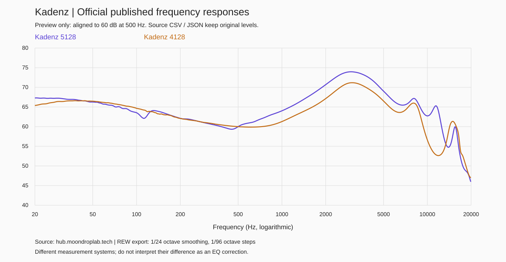

# Kadenz 终章：声音特性与 EQ 调节指南

本文根据官方 5128、4128 两份频响和项目内 EQ 实现，说明 Kadenz 与 ECHO-B 的调音方法。官方数据不代表用户这副耳机的耳内响应或当前播放链路的实测结果。

**最值得保留的认识：Kadenz 的曲线有向深低频倾斜的低频量感、约 3 kHz 的宽幅存在感隆起，以及之后回落的高频轮廓。调音应先处理低频量感、人声厚度和上中频存在感之间的关系，再根据实际佩戴处理高频。约 3 kHz 的隆起不能直接削平，10 kHz 以上的凹谷也不能直接补平。**

这里的“深低频”“人声厚度”“存在感”等是操作性描述，频带相互重叠，不是声音与单一频率的一一对应。后文明确区分数据观察、听感推断与试听假设。

## 1. 证据与适用范围

| 证据 | 能回答什么 | 不能回答什么 |
| --- | --- | --- |
| 官方两份频响，每份 957 点 | 在各自测量条件下的频响轮廓、频段内部相对量 | 你的耳内响应、所有导管/耳套效果、个体左右差异 |
| 产品官方规格 | 产品结构、配件与厂商标称条件 | 音色优劣、材料对应的“速度感”、全频段失真余量 |
| HBK / GRAS 测量资料 | 仿真耳、插入深度、密封对测量的影响 | 将一台测量架曲线精确换算成另一台或你的耳朵 |
| 听音偏好研究 | 频谱平衡的重要性和偏好差异 | 为你指定唯一正确目标 |
| 本项目 DSP 代码与读回记录 | ECHO-B 可写的参数、格式、运行系数与限制 | 未做的模拟输出测量、内部各级溢出情况 |

原始数据源与条件见[资料说明](measurements/README.md)。两份文件均已做 1/24 倍频程平滑、以 1/96 倍频程步长导出；“原始”表示未施加本项目 EQ，并不表示未经测量软件处理。

官方条目没有注明导管、耳套、插入深度、样机及完整校准条件。5128 标注日期为 2024-08-28，4128 为 2023-07-04；后者只按文件头记录，不能据此认定产品历史或样机身份。两份文件均不提供可单独分析的完整左右声道集合。

Kadenz 官方标称为 10 mm 单动圈，提供可换导管与两类耳套；规格中的 35 Ω、122 dB/Vrms 和失真指标都有指定条件。它们不能证明增加低频 EQ 后仍有同样失真水平。页面同时出现“双规格导管”文字与“ABC”配件列表，本指南不凭此推定 A/B/C 的长度、亮度排序。[官方产品页](https://moondroplab.com/cn-products/kadenz)

## 2. 如何读这两条曲线

两套数据的原始 500 Hz 数值分别为 56.03 和 74.68 dB，纵向基准相差约 18.65 dB。**这不是两副耳机的响度差，也不是应补偿的 EQ。** 本文将每条曲线各自的 500 Hz 归零，再描述形状；指定频点用对数频率上的线性插值取得。没有把两套曲线平均，没有将其中一条当作另一条的目标。

已有对照图在 500 Hz 对齐到 60 dB，形状与本文归零方式相同，仅纵坐标差一个常数：



图中曲线不是“与中性音色的偏差”。仿真耳测量包含耳道声学负载；自然听觉的参考响应也不要求在原始测量坐标上呈一条水平线。频响目标必须与测量系统、补偿定义和归一化方式匹配；不能直接拿传统 711/4128 的目标去减 5128 数据。HBK 说明了 4128 的圆柱耳道和 5128 的解剖式耳道设计差别，但这不等于 5128 就是你的耳道。[HBK 测量系统说明](https://www.bksv.com/de/knowledge/blog/sound/high-frequency-hats)

**本研究没有取得并校验匹配的目标曲线，因此不声称 Kadenz 比 Harman、VDSF 或某个“中性”目标多/少几 dB，也不据此给目标符合度打分。**

## 3. 定量轮廓：真正稳定的是什么

下表均相对各自的 500 Hz，保留两位小数用于复算，不意味着测量具有 0.01 dB 的实物准确度。

| 频点 | 5128 | 4128 | 对调音有意义的观察 |
| --- | ---: | ---: | --- |
| 30 Hz | +7.20 dB | +6.40 dB | 两套均有明显的深低频抬升 |
| 50 Hz | +6.27 dB | +6.47 dB | 低频轮廓的共同部分很接近 |
| 100 Hz | +3.54 dB | +4.67 dB | 比深低频低，局部差异不能忽略 |
| 200 Hz | +2.11 dB | +2.08 dB | 低频逐渐收回，不是持续延伸至中频的高平台 |
| 300 Hz | +0.90 dB | +1.02 dB | 下中频未表现为宽幅隆起 |
| 800 Hz | +2.67 dB | +0.21 dB | 两套中频转折位置不同 |
| 1 kHz | +4.03 dB | +1.29 dB | 不能把归一化后的差异全归因于器材听感 |
| 2 kHz | +10.68 dB | +7.14 dB | 上中频已明显抬升 |
| 3 kHz | +13.96 dB | +11.17 dB | 共同的宽幅峰顶附近 |
| 4 kHz | +12.35 dB | +9.46 dB | 峰后逐步回落 |
| 6 kHz | +6.22 dB | +3.93 dB | 较 3 kHz 有明显收敛 |
| 8 kHz | +7.14 dB | +5.98 dB | 局部回升，具体位置受佩戴影响 |
| 10 kHz | +2.74 dB | −3.38 dB | 已有约 6.12 dB 跨数据差异 |
| 12 kHz | +3.52 dB | −7.36 dB | 相差约 10.88 dB，不宜据单条曲线补偿 |

完整数表、频段均值和计算结果在[分析数据](analysis/summary.md)。频段均值是在对数频率上对 dB 积分得到的描述量，不是声能、响度或偏好分数。

### 3.1 低频：深低频比上低频更突出

两套曲线从 50 Hz 到 200 Hz 分别下降约 **4.15 / 4.39 dB**。20–60 Hz 的对数频率均值为 **+6.81 / +6.27 dB**，60–200 Hz 为 **+3.83 / +4.29 dB**。共同趋势比单个 20 Hz 或 100 Hz 点可靠：低频有量感，但更偏向底部延伸，向中频逐渐收回。

**听感推断：**密封良好时，低音下潜与电子低音的基础重量可能较容易感知；这不必然意味着鼓点中低频很肥厚，更不能从曲线推断瞬态快慢、低频纹理或“弹性”。若听起来低频很少，应先排查密封；若只是底鼓缺一点肉感，盲目增加 30 Hz 未必有效。

5128 在约 112 Hz 有局部下凹，4128 并未给出相同轮廓。没有多次佩戴重测支持，不把它当成必须精确补偿的固定缺陷。

### 3.2 下中频与中频：厚度是可调维度，但不能先验认定“人声凹”

200–500 Hz 两套曲线的均值接近（+0.72 / +0.93 dB），没有宽大的低中频隆起。最低点分别约在 453 Hz 和 604 Hz，位置不同。由此可把“人声/乐器是否够厚”作为试听问题，但不能直接说 Kadenz 的男声薄、冷或退后。

**听感推断：**在深低频与上中频的对照下，中间部分可能显得干净、轮廓清楚，也可能被部分人听成偏轻。人声是否“近”不仅取决于 300–800 Hz，还与 1–4 kHz、录音和播放响度共同相关。若人声偏薄但已经贴脸，优先尝试很小的中频厚度调整，不应继续整体抬升 2–4 kHz。

### 3.3 上中频：约 3 kHz 是最明确的结构，但不是 14 dB 的错误

峰顶分别位于约 **2.98 / 3.04 kHz**。若换用 1 kHz 作为比较基准，两套曲线到 3 kHz 的上升量是 **9.93 / 9.88 dB**，几乎相同。这比“5128 峰顶比 4128 高约 3 dB”更能说明共同结构，也显示归一化锚点会影响表述。

**听感推断：**人声谐波、咬字与许多乐器的存在感可能比较鲜明；若佩戴和个人耳道使这段过强，可能出现高声部顶耳、喊声或长听紧张。若觉得自然，应该保留。缺少匹配目标时，不能因为图上有 +14 dB 就下一个 −14 dB 的峰值滤波；那会把参考耳道响应也一并消掉。

初次试验若确实“顶”，可在 3 kHz 附近做宽的 −1 至 −2 dB 变化，而不是用很窄的陷波切掉峰尖。此建议是小步诊断策略，不是已经证实的最佳校正。

### 3.4 4–8 kHz：从存在感回落，但局部亮度仍在

两套曲线分别在约 6.74 / 6.45 kHz 出现局部低点，之后在约 8.07 / 8.01 kHz 回升。由此不能简单称整副耳机“暗”或“刺”：2–4 kHz 的前冲、5–6 kHz 的攻击感和更高频的齿音可以在同一副耳机上呈现不同程度。

**听感推断：**它可能同时有较清楚的人声存在感和较收敛的部分高频攻击感；是否有齿音必须用多段录音与重复佩戴确认。两个图上都有约 8 kHz 峰，并不证明你的耳内峰也固定在那里。移动导管/插入深度可能改变有效耳道长度和高频共振。[GRAS 入耳测量白皮书与来源摘记](research/sources.md)

### 3.5 8–20 kHz：信息最不稳定，优先试听，不做精密反向拟合

500 Hz 对齐后，8–12 kHz 两套曲线的平均差异约 **5.99 dB**，该段最大采样点差异约 **12.48 dB**。12 kHz 以上两套曲线的整体均值又很接近，但局部仍相差超过 10 dB；**频段均值接近不代表峰谷位置相同。**

因此不能把某条曲线的 12–14 kHz 深谷直接补十几 dB，也不能从某条延伸较高就宣称空气感一定更好。测量架、佩戴、耳套和样机条件都有可能贡献差异，本数据无法分离各自的影响。文件上限为 19,896.97 Hz，没有直接的 20 kHz 测量点。

## 4. 从听感问题到可验证的 EQ 假设

下面每一行都应**单独尝试**。频率是起点，增益是试验幅度，不是从目标曲线拟合出的校正值。没有对应听感问题时，不需要添加滤波器。这里列的不是一套应同时叠加的八段 EQ。

| 具体问题 / 目的 | 先排查 | 单段试验起点 | 应听到的变化与撤回条件 |
| --- | --- | --- | --- |
| 底部重量不足 | 耳套密封、佩戴是否稳定 | `low_shelf`，80 Hz，+2 dB，`q=1` | 深低频更有重量；若只是更轰、人声被掩盖则撤回；注意后文高采样率误差 |
| 低频整体偏多 | 是否只是一首歌或音量变大 | `low_shelf`，120 Hz，−2 dB，`q=1` | 低频更克制；若音乐失去底座则减小削减 |
| 鼓点/低音显得糊 | 先区分低频多与中低频厚 | `peak`，180 Hz，−2 dB，Q=0.8 | 减少中低频厚重；若低音乐器太瘦则撤回 |
| 人声/乐器偏薄 | 上中频是否已经很近 | `peak`，700 Hz，+1 dB，Q=0.8 | 尝试增加中频肉感；若鼻、闷、箱声增加则撤回或换频率 |
| 人声高声部顶耳 | 多首歌均出现，排除音量差 | `peak`，3000 Hz，−2 dB，Q=1 | 降低上中频压迫；若咬字和鲜活感损失则退到 −1 dB |
| 拨弦/敲击轮廓不够清楚 | 不要把“整体更小声”当成暗 | `peak`，5500 Hz，+1 dB，Q=1 | 稍加攻击感；若出现硬、砂、疲劳感则撤回 |
| 齿音/镲片某处刺 | 换录音、重新佩戴，确认大致频段 | `peak`，7500 Hz，−2 dB，Q=2 | 只是候选起点，不代表峰固定在此；位置不对时不要加大削减 |
| 想要少量空气感 | 先确认不是密封或上中频平衡问题 | `high_shelf`，10000 Hz，+1 dB，`q=1` | 对空气感的低置信度试验；若只有嘶声增加就撤回 |

以上起点已通过现有编译器的五采样率系数范围与稳定性离线检查，测试统一使用 −3 dB 全局增益。**这只证明可以生成相应计划，不等于滤波在所有采样率都精确实现、没有内部削波或实际更好听。** 完整响应检查见[示例滤波离线检查](analysis/filter-examples.json)。未创建上述预设，未试听，未写入设备。

优先顺序建议为：确认佩戴 → 低频整体量感 → 2–4 kHz 是否顶 → 中频厚度 → 高频局部。这样通常只需 1–3 段就能判断方向；没必要为了用满八段而制造问题。

## 5. 目标曲线和个人口味的关系

频响目标是起点，听音偏好不是只有一个答案。原作者的听音研究指出，频谱平衡与偏好相关，低频/高频偏好也受到个人及节目内容影响；这并不能推导出本用户应采用哪个群体平均值。[Sean Olive：偏好研究概述](https://seanolive.blogspot.com/2022/03/the-perception-and-measurement-of.html?m=1)、[低频与高频偏好研究](https://seanolive.blogspot.com/2015/11/factors-that-influence-listeners.html)

对本项目更实用的是三种不同的基准，不要混用：

1. **恢复基准：**以首次备份为依据恢复运行状态；它不是“中性目标”，也不是完整恢复出厂。
2. **响度基准：**保持频响形状，仅调整整体电平，用于区分音量与音色的影响。
3. **口味预设：**例如减低频、柔和人声、略增加厚度。每份描述一个目标，并保留与基准的变化记录。

若以后做自动拟合，必须先拿到来源明确、测量架匹配、定义清楚的目标，再检查归一化、有效频段和平滑程度。这里不拿未知导管数据、另一测量架目标或未经核对的网上十段参数直接导入。

## 6. ECHO-B 实现对调音的实际约束

以下是**本项目当前工具**的实现范围，不是声明 ECHO-B 全部硬件能力。对应代码：[preset.py](../../../tools/preset.py)。

| 项目 | 当前情况 | 对调音的影响 |
| --- | --- | --- |
| 滤波数量 | 最多 8 段音色滤波，第 9 段控制整体输出数字增益 | 预设保持简洁，不照抄超过八段的方案 |
| 单段类型 | `peak`、`low_shelf`、`high_shelf` | 可处理宽幅音色和局部峰值 |
| 增益精度 | 滤波增益接受 0.1 dB 步进；全局增益可用小数 | 上文整 dB 示例仅为试验起点，可进一步微调；设置步进不等于量化后各频点的实现精度，设备整数标签也不代表实际小数增益 |
| Q 与架式 | 峰值 Q 量化为 1/256；架式 `q=1` 实际固定斜率 S=1 | 别直接把别的软件 shelf Q 数字抄过来 |
| 系数 | 24 位有符号容器、Q22 | 高采样率下低频滤波可能有明显量化误差 |
| 写入 | 为 44.1/48/96/192/384 kHz 各生成数据，随后保存 | 生成五套数据不等于逐一做过实机声学验证 |
| 读回 | 当前模式、标签、当前运行系数 | 不等于完整闪存镜像或拔插持久化证明 |

**量化响应示例：**80 Hz、+2 dB 低架，加全局 −3 dB。在 20 Hz–20 kHz 的 601 个检查点上，总响应最大值在 48 kHz 时为 −1.014 dB，而在 192 / 384 kHz 时约为 −0.624 / −0.551 dB；还原全局衰减后，后两者峰值约为 +2.38 / +2.45 dB。数值为系数的理论响应，不是模拟输出测量。低频提升应检查实际使用采样率的量化响应，不能仅凭“编译成功”认定与输入参数完全一致。

**全局衰减的位置也有边界：**当前代码把它放在第 9 段。组合频响不超过 0 dB，有助于控制最终稳态幅度，但不能证明前面级联滤波器的内部节点不会溢出；硬件内部精度与余量尚未实测。不要把最终负增益当作允许大幅叠加多个正增益的保证。保留余量、优先小幅调整，并在试听中检查异常失真。滤波定义参考 [RBJ Audio EQ Cookbook](https://www.w3.org/TR/audio-eq-cookbook/)。

设备操作与字段规则见[操作指南](../../../docs/operations.md)和[JSON 格式](../../../presets/README.md)。

## 7. 试听与记录方式

先固定导管、耳套型号/尺寸和佩戴方式；每次换其中任何一项，都应重新判断原有 EQ 是否还合适。当前尚不知道你实际采用的组合，不能在文档中把它默认为 B 导管或清泉套。

选 3–5 段自己熟悉、容易重复比较的录音：低频持续音和底鼓、人声高声部与齿音、原声乐器、镲片/密集编曲。记录具体版本和 15–30 秒片段即可，不必为了测耳机换成陌生“发烧曲”。先比较一个变化，避免同时换 EQ、播放器音效和音量。

比较时尽量匹配听感响度；系统音量数字相同并不保证不同 EQ 一样响。如果某版只因更响而显得“细节更多”，先调整比较音量再判断。只改变整体增益的对照可以帮助识别音量因素。预设评价至少覆盖几段录音和重复佩戴，避免只为一首混音特殊的歌修正整副耳机。

实际试听数据保存在 `headphones/moondrop/kadenz/listening/`，使用以下字段：

```text
日期 / 预设文件及版本：
导管 / 耳套型号与尺寸 / 密封是否稳定：
设备 / 播放器 / 其他音效 / 采样率：
对照预设 / 两边音量与响度匹配方式：
曲目版本 / 时间段：
目标问题与单项调整：
改善了什么 / 损失了什么 / 重复佩戴后是否仍成立：
决定：保留、缩小改动、撤回、待验证
对应 runs 日志 / 拔插后结果：
```

预设文件名可按用途和版本，例如 `vocal-relaxed-v1.json`；导管、耳套、目的写进 `description` 或旁边的试听记录，**不要随意新增 JSON 字段**，当前编译器会拒绝未知字段。

## 8. 频响数据的结论边界

- 没有测得你的耳内响应，不能给你的齿音峰定位到一个确定频率。
- 没有完整的失真/动态/多音测试，不能从频响平滑或单动圈结构推断解析力、速度、分离度、声场或低频提升极限。
- 没有足够的参考和时间信息，不用原始文件里的相位重建已验证的绝对延时，也不据此做相位校正。
- “高频较收敛”“人声存在感明显”在这里是曲线关系引出的听感假设，不代表每个人都听成柔和或贴脸。
- 没有测量当前连接链路的声学输出，不把网页曲线宣称为你这副 Kadenz + 当前 ECHO-B 设置的实测结果。

## 9. 文件索引与复算

- [官方原始频响与来源记录](measurements/README.md)
- [外部一手证据与限制](research/sources.md)
- [完整统计表](analysis/summary.md)
- [统计 JSON，含原文件 SHA-256](analysis/statistics.json)
- [逐点归一化曲线 CSV](analysis/normalized-500hz.csv)
- [示例滤波离线检查](analysis/filter-examples.json)
- [离线复算脚本](../../../tools/analyze_kadenz.py)：`python3 tools/analyze_kadenz.py`

复算脚本先核对原 TXT 的哈希、全部数字与整理 JSON 一致，再计算统计和示例。它不访问 USB、不调用写入程序、不覆盖原始频响数据。
