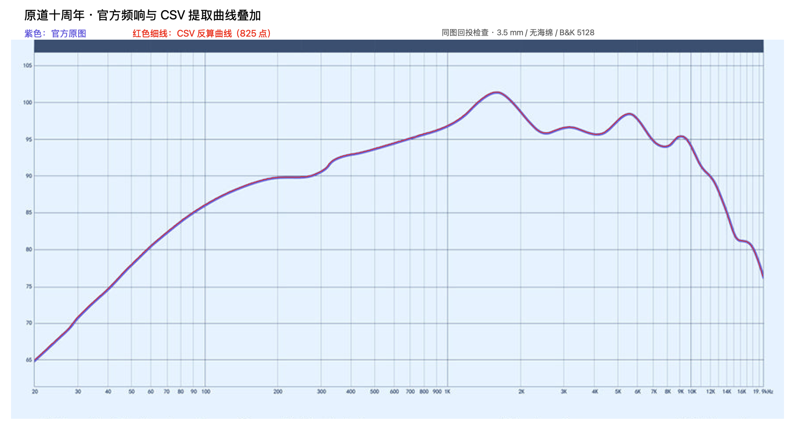

# CSV 与官方原图叠加检查

紫色是原图，红色细线由**已保存 CSV**中的频率与图示纵轴值反算坐标后绘制。展示图将原图曲线区域放大 2 倍；以下偏差均按原图像素计算。视觉检查确认低频斜坡、约 1.6 kHz 主峰和高频起伏均贴合，没有明显整段偏移。

| 检查 | 结果 |
| --- | --- |
| CSV 点落在检测到的原图线条范围内 | 825 / 825 |
| CSV 反算与原提取中位中心的最大垂直差 | 0.0416 像素，约 0.005 dB |
| 与另一种颜色加权中心的平均绝对差 | 0.211 像素，约 0.025 dB |
| 与另一种颜色加权中心的 95% 绝对差 | 0.486 像素，约 0.058 dB |
| 与另一种颜色加权中心的最大绝对差 | 1.716 像素，约 0.205 dB |
| 横轴标定最大刻度残差 | 0.785 像素 |
| 纵轴标定最大刻度残差 | 0.950 像素，约 0.114 dB |

**结论：CSV 很好地保留了发布图片的曲线形状，叠加差异很小，无须因本次检查重新提取。**

检查含义要区分：使用同一标定反算回同一张图，接近零的回投偏差主要说明 CSV 舍入和坐标还原正确，不能独立证明坐标标定无误。颜色加权中心使用另一种方法重新估计同图线条中心（逐列权重 `max(0, min(B-R, B-G)-35)`），可检查中心选择的敏感性，但同样不是独立声学实测或统计误差界限。纵轴换算只是图示 dB，不代表耳内声压精度。

- [详细检查结果和输入文件 SHA-256](comparison.json)
- [从 CSV 反算的像素坐标](points.json)
- [叠图渲染脚本](render_overlay.swift)
- [CSV 与精度说明](../README.md)

图像渲染使用 macOS AppKit。保存的 PNG 是分析展示副本，官方 JPEG 原件未改变。
