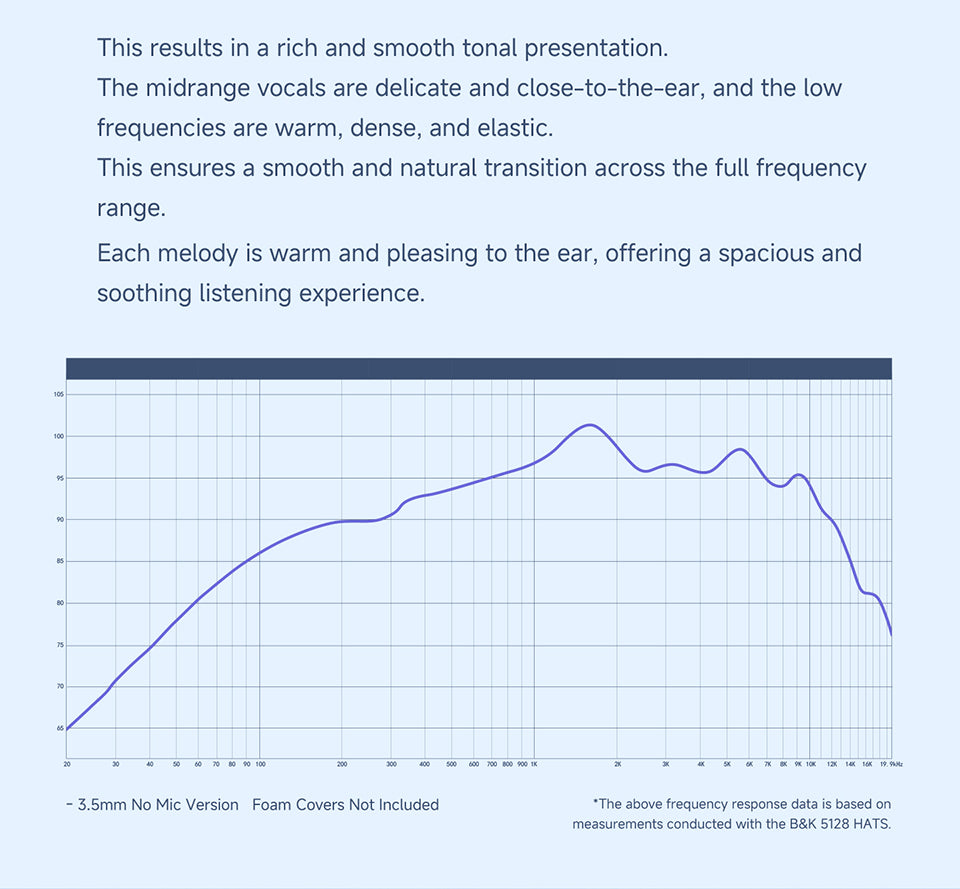

# 原道十周年频响曲线调研

调研日期：2026-11-01。目标为 NICEHCK / YUANDAO 十周年纪念版，重点服务于用户的 **3.5 mm 版本＋全包海绵＋ECHO-A** 使用场景。本次只保存声学资料与调研结论，未修改调音配置或操作耳放。

## 已取得的曲线

目前可直接核对并归档的是**官方发布的无海绵曲线**，不是用户全包海绵条件下的实测。英文商品页原图已存在，本次重新获取后逐字节一致；中文官网的展示图本次新增归档。[英文商品页](https://www.nicehck.com/products/yuandao-10th) · [中文商品页](https://www.nicehck.cn/store/10years)

| 资料 | 测量条件／内容 | 本地原件 |
| --- | --- | --- |
| 英文官网完整频响图 | 图注明 3.5 mm、无麦、不戴海绵、B&K 5128 HATS；单条曲线 | [完整原图](../measurements/raw/06_15b37029-c621-4a3d-bb60-f66028fc9bbb.jpg) |
| 中文官网“特调音色”图 | 人头模型佩戴耳机的展示图，背景有曲线，中段被遮挡；图中无完整测量条件文字 | [中文原图](../measurements/raw/sxS3b38qWN1PzR11cXjnB64X9Uc.jpg) |

中文图可见部分的曲线形状与英文完整图相近；这是视觉比较，**不能证明两图是不同样机、不同佩戴条件或独立复测**。因此不把两张营销素材算作两组测量。来源为上述官方页面及其图片链接。

## 曲线怎么读

下表为对[完整官方图](https://cdn.shopify.com/s/files/1/0865/0850/3331/files/06_15b37029-c621-4a3d-bb60-f66028fc9bbb.jpg?v=1773218463)的**近似定性读图**。频段边界不是精确峰谷定位。后续按用户要求生成了[图片数字化估算 CSV](../measurements/digitized/README.md)，该衍生文件不是厂商原始采样数据。

| 频段 | 图中可观察到的形状 |
| --- | --- |
| 20–100 Hz | 向低频方向明显下降；深低频相对中频低很多 |
| 100–300 Hz | 低频向中频逐步抬升，约 200–300 Hz 一带较平缓 |
| 300 Hz–1 kHz | 总体继续上升 |
| 约 1.5–1.7 kHz | 一个较宽的主峰，不能视为孤立窄共振 |
| 约 2–4 kHz | 从主峰回落，存在较小起伏 |
| 约 5–6 kHz | 另一个局部隆起 |
| 约 7–10 kHz | 先回落后有小幅起伏 |
| 10 kHz 以上 | 整体下降，最高频端滚降更明显 |

纵轴只有图上刻度，未交代驱动电平、归一化方法、校准和目标曲线。它可以帮助识别该图的相对形状，不能据此计算用户耳内声压、播放音量或把产品标称灵敏度当成图的输入条件。以上限制来自对原图可见标注的核对。

## 海绵与测量系统的限制

官方海绵说明称海绵可增加低频、优化佩戴，但没有给出海绵前后差值曲线或可用的固定 dB 修正量。[官方海绵说明原图](https://cdn.shopify.com/s/files/1/0865/0850/3331/files/12_4bfb0b4b-2e94-43aa-b5e0-4c67fc74e7e0.jpg?v=1773218483) · [本地原件](../measurements/raw/12_4bfb0b4b-2e94-43aa-b5e0-4c67fc74e7e0.jpg)

B&K 的耳机测试说明明确提出须考虑耳廓与真实声学负载；5128 模拟成人头部与躯干声学特性。因此，本报告不把图中各频率的原始声压拉成同一高度作为 EQ 目标，也不把 1.6 kHz 隆起全数认定为耳机缺陷。这是依据测量原理作出的调音边界判断。[B&K 耳机测试说明](https://www.bksv.com/en/knowledge/applications/electroacoustics/headphone-testing)

本轮取得的官方图没有分别呈现左右声道、样机数量、多次摆位、平滑方式、失真或全包海绵响应；不能由单条曲线证明一致性、瞬态、失真表现或主观“解析力”。3.5 mm＋ECHO-A 的声学响应也不能由 Type-C 官方 DSP 参数单独推得；厂商将内置 DAC/DSP 功能限定在 Type-C 版本。[官方版本说明图](https://cdn.shopify.com/s/files/1/0865/0850/3331/files/07_5da945f6-a44e-42d0-b966-53d07ed656b5.jpg?v=1773218492)

## 独立测量与原始数据查找

检索覆盖中英文型号、频响／frequency response、海绵／foam、Squiglink，以及油兔几《原道 十周年 详细测试》。逐项来源和访问结果另存于[独立来源核验记录](independent-frequency-response-20261101.md)。

本轮尚未取得可核对的**全包海绵独立曲线或原始频响 CSV/TXT**。这是本次资料获取的边界，不代表网络上不存在。油兔几的视频是后续优先补齐的测量线索；在取得画面、说明与测量条件前，不把视频标题转写成任何具体峰谷或 EQ 数字。[油兔几原视频](https://www.bilibili.com/video/BV1d7XCB5EHP/)

## 对个人调音的含义

以下为设计推论，不是官方测量直接证明的听感：

- 想要适度低频冲击，可以先试听有限的低频调整；官方裸塞低频滚降不能支持对全包海绵一口气做大幅反向补偿。
- 为了 riff 辨识度而调整中频时，应看完整 EQ 叠加曲线；不能从官方 1.6 kHz 宽峰直接推导出“必须削减多少 dB”。
- 在全包海绵和个人摆位没有实测时，高频峰谷只作参考，不做逐个窄带填平。
- [已创建的 Riff 与冲击 v1](../../../../presets/echo-a/nicehck/yuandao-10th/custom/README.md)仍属于个人偏好导向的试听假设，不能称为这副耳机的精确测量校正。

## 原件与追溯

原图保持上游字节，未裁切、重绘或编辑。英文图本次复核 117,970 bytes，SHA-256 `f33afca9e0d57c1fe81b5152fd86b82b8d1207d466d5c1be296c5fc40aafa09e`；中文图 144,511 bytes，SHA-256 `9dd6b7b25edc73568a55a0697a461843466744cd71896fdc51878237a205fe3a`。

- [原始来源清单](../measurements/provenance/sources.json)
- [英文完整图本次复核记录](../measurements/provenance/frequency-response-recheck-20261101.json)
- [中文展示图下载与校验记录](../measurements/provenance/chinese-official-curve-20261101.json)

返回[耳机资料库](../README.md)。

## 图片数字化 CSV

按用户后续要求，已从完整官方图提取 [825 点 CSV](../measurements/digitized/official-unfoamed-5128-image-estimate.csv)，包含频率、图示纵轴估算值及以 1 kHz 为基准的相对值。范围约 20.12–19806.14 Hz，无外推；方法及精度限制见[数字化说明](../measurements/digitized/README.md)。这没有补齐全包海绵或厂商原始数值测量。
